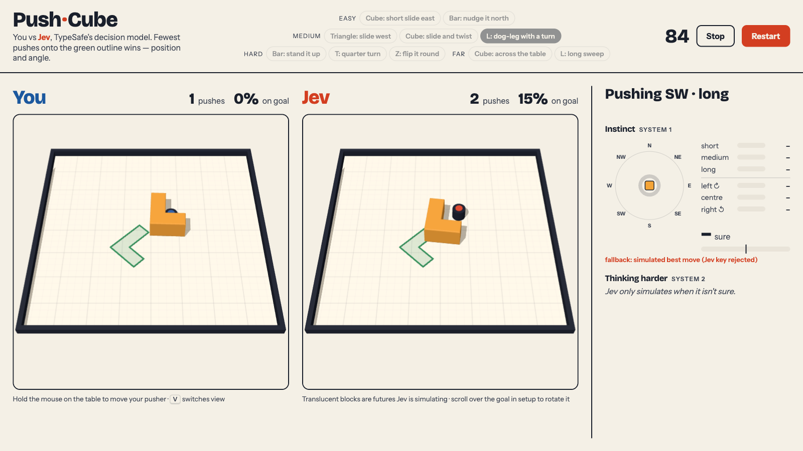
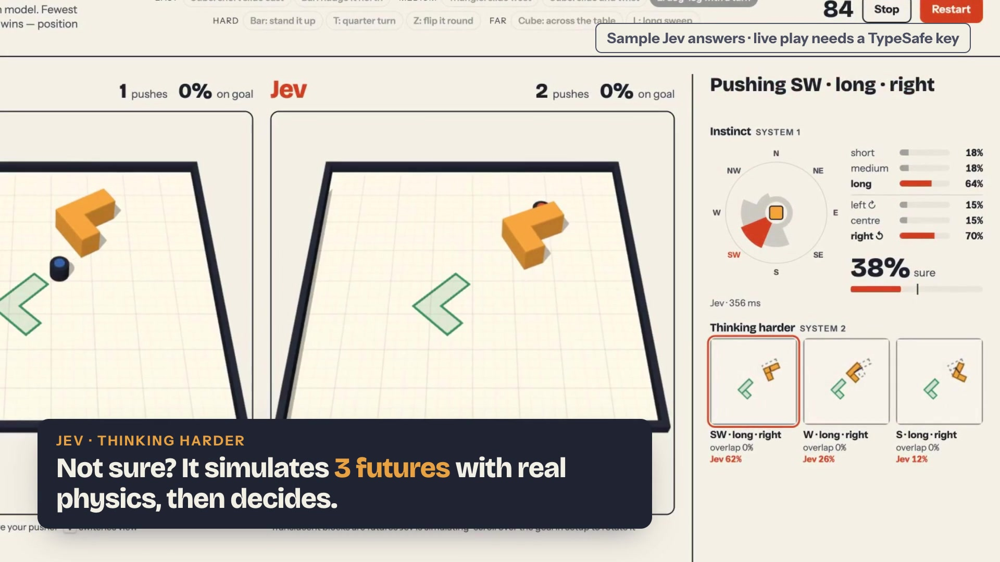

# Push·Cube — You vs Jev

**Can you out-push a decision model?** You and TypeSafe's decision model **Jev** race to push a block
onto a green outline, matching its position *and* angle. Whoever needs the fewest pushes wins, and
the panel on the right shows what Jev is thinking while it plays.



[](brag-output/brag.mp4)
<sub>Demo video (32 s). The decision-panel scenes use sample Jev answers, because live play needs a working TypeSafe key.</sub>

## How it works

- **Six block shapes:** square, T, L, I-bar, Z and triangle. They slide and spin under real 2D
  physics ([pymunk](https://www.pymunk.org/)), drawn in 3D with [Three.js](https://threejs.org/).
- **Ten challenges** in four tiers (easy, medium, hard, far), or drag and rotate the goal yourself.
- **System 1 (instinct):** every push, Jev reads raw coordinates and returns probabilities for the
  push **direction** (8), **distance** (short, medium, long) and **aim** (left, centre, right of
  the face).
- **System 2 (thinking harder):** when Jev's confidence is below `JEV_TAU`, the AI simulates its top
  three candidate pushes with the same physics, shows them as translucent "futures", and asks Jev
  to pick one.
- **Fair scoring:** a push starts on contact and ends once the pusher has stayed clearly away for
  0.3 s, with the same rule for both players. A board is solved at 90 % overlap with the goal.

## Quick start

Requires Python 3.11+ and [uv](https://docs.astral.sh/uv/).

```bash
cp .env.example .env            # then put your TypeSafe key in TYPESAFE_API_KEY
uv sync
uv run --env-file .env uvicorn pushcube.server:app --port 8000
# open http://localhost:8000
```

1. Pick a challenge at the top, or drag the green goal on either board (scroll over it to rotate).
2. Press **Start round**. You have 90 seconds.
3. Hold the mouse on the **You** board to drive your pusher. Press `V` to switch between the tilted
   and top-down views.

**No key?** The game still runs. Jev's board falls back to a one-step oracle (it simulates every
push and plays the best one), and the page says why Jev is offline.

## Configuration

| Variable | Default | Purpose |
|---|---|---|
| `TYPESAFE_API_KEY` | none | Jev API key. Keep it in `.env` only (gitignored); it is never sent to the browser. |
| `JEV_TAU` | `0.5` | Confidence below which Jev "thinks harder" (System 2). |
| `RECORD_TO` | none | Append every broadcast message to this JSONL file. |
| `REPLAY_FROM` | none | Replay a recorded JSONL file to every browser instead of playing live. |

## Tools

```bash
uv run pytest -q                                              # test suite (~740 tests, ~25 s)
uv run --env-file .env python scripts/dry_run_jev.py           # check the key, then let Jev play two presets
uv run --env-file .env python scripts/harness.py --repeats 3   # Jev vs geometric rule vs one-step oracle
RECORD_TO=recordings/round.jsonl uv run --env-file .env uvicorn pushcube.server:app   # record rounds
REPLAY_FROM=recordings/round.jsonl uv run uvicorn pushcube.server:app                 # replay (stage fallback)
```

## Project layout

| Path | What it does |
|---|---|
| `pushcube/sim.py`, `shapes.py` | 2D pymunk table, pusher and block shapes |
| `pushcube/options.py`, `executor.py` | The 72 discrete pushes and how the pusher carries one out |
| `pushcube/scoring.py` | Overlap with the goal, goal clamping, push counting |
| `pushcube/jev_judge.py` | TypeSafe Jev client (decide and pick), with fallback and logging |
| `pushcube/controller.py` | The AI loop: decide, think harder when unsure, act |
| `pushcube/policies.py` | Geometric rule of thumb and one-step oracle baselines |
| `pushcube/game_round.py`, `challenges.py` | Round state, winner rule and preset challenges |
| `pushcube/server.py` | FastAPI app, WebSocket protocol, record and replay |
| `pushcube/static/` | Three.js boards and Jev's decision panel (no build step) |
| `scripts/` | Jev dry run and play-quality harness |
| `brag-output/` | Demo video and its HyperFrames source |

Design and plan: [`docs/superpowers/specs/2026-11-10-push-cube-vs-jev-design.md`](docs/superpowers/specs/2026-11-10-push-cube-vs-jev-design.md),
[`docs/superpowers/plans/2026-11-10-push-cube-vs-jev.md`](docs/superpowers/plans/2026-11-10-push-cube-vs-jev.md).
